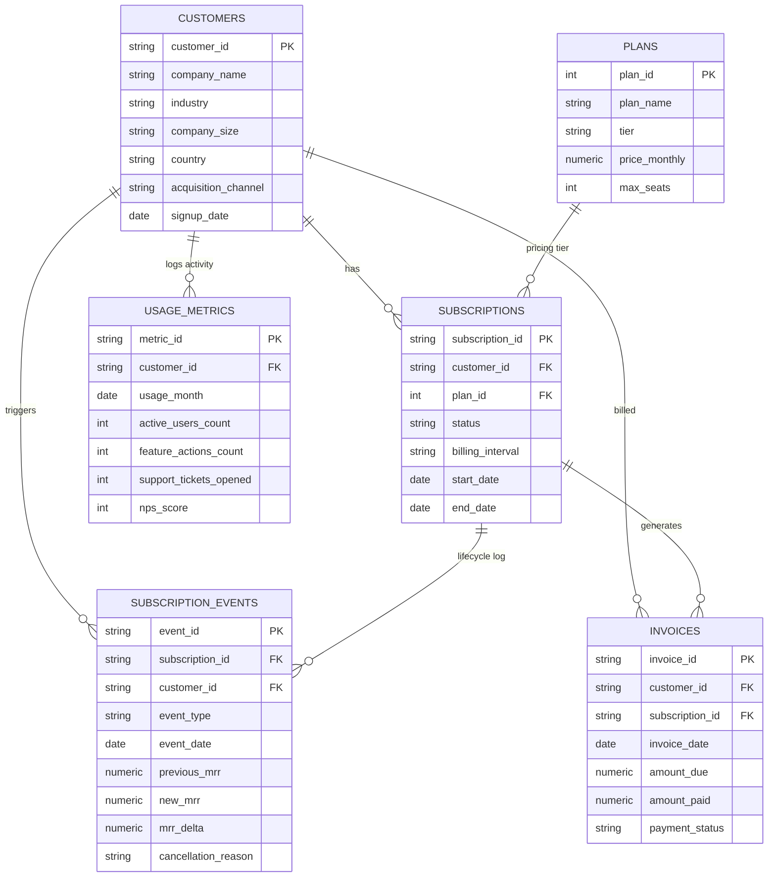

# 📈 SaaS Subscription & Cohort Retention Analytics Engine

> A production-grade SQL analytics suite modeling B2B SaaS revenue dynamics, triangular cohort retention matrices, customer lifetime behavior, and query performance tuning.

---

## 🌟 Executive Summary

In subscription businesses (SaaS), standard transactional queries fail to answer the most critical executive questions:
- *Are we growing through new acquisitions or expansion of existing accounts?*
- *What is our Month-1, Month-3, and Month-12 cohort user retention rate?*
- *Is our Net Retention Rate (NRR) above 100%, indicating sustainable organic expansion?*
- *Which enterprise accounts are exhibiting behavioral drop-offs that signal imminent churn?*

This project engineers a normalized subscription data warehouse and delivers **5 advanced analytical SQL pipelines** solving these core business challenges.

---

## 🏗️ Architecture & Data Model (ERD)



---

## 📊 Analytical SQL Breakdown

### 1. Monthly Recurring Revenue (MRR) Bridge / Waterfall (`01_mrr_revenue_bridge.sql`)
- **Business Purpose**: Tracks how MRR evolves month-over-month across 5 key revenue vectors: Beginning MRR, New MRR, Expansion MRR, Contraction MRR, Churned MRR, and Reactivated MRR.
- **Key Techniques**:
  - Multi-stage Common Table Expressions (CTEs).
  - Conditional aggregation (`SUM(CASE WHEN ...)`).
  - Window functions: `LAG()` for beginning balance and unbounded running total for ending MRR.

### 2. Triangular Cohort Retention Matrix (`02_cohort_retention_matrix.sql`)
- **Business Purpose**: Measures what percentage of customers acquired in Cohort Month $X$ remain active and paying in Month 0, 1, 2, 3, 4, 5, 6, 9, and 12.
- **Key Techniques**:
  - Normalized cohort indexing `(year_diff * 12 + month_diff)`.
  - Dynamic cohort size denominators.
  - Pivot matrix aggregation producing triangular retention heatmaps.

### 3. Executive Unit Economics: NRR & GRR (`03_nrr_grr_kpis.sql`)
- **Business Purpose**: Computes board-level metrics:
  $$\text{GRR} = \frac{\text{Beginning MRR} - (\text{Contraction} + \text{Churn})}{\text{Beginning MRR}} \times 100$$
  $$\text{NRR} = \frac{\text{Beginning MRR} + \text{Expansion} - (\text{Contraction} + \text{Churn})}{\text{Beginning MRR}} \times 100$$
- **Key Techniques**: Safe division guards (`CASE WHEN`), ratio analysis, and growth trajectory tracking.

### 4. Behavioral Churn Risk & Health Scoring (`04_churn_health_score.sql`)
- **Business Purpose**: Early-warning algorithm alerting Customer Success teams before high-value accounts cancel.
- **Key Techniques**:
  - Trailing 3-month moving average of active users using `ROWS BETWEEN 3 PRECEDING AND 1 PRECEDING`.
  - Recency window ranking (`ROW_NUMBER() OVER (PARTITION BY ... ORDER BY ... DESC)`).
  - Multi-factor risk scoring penalizing engagement drops, spike in support tickets, low NPS, and payment failures.

### 5. Performance Tuning & Indexing (`05_performance_tuning.sql` & `scripts/benchmark_tuning.py`)
- **Business Purpose**: Optimizes query latency on large-scale analytical tables.
- **Optimization Results**:
  - Before Indexing: `SCAN TABLE invoices` (Full sequential table scan across 5,000+ rows).
  - After Covering Index: `SEARCH TABLE invoices USING COVERING INDEX idx_invoices_status_date_cust (payment_status=?)`.
  - Eliminated table heap lookups, converting $O(N)$ operations into $O(\log N)$ B-Tree index seeks.

---

## 🚀 How to Run

### Prerequisites
- Python 3.10+
- Built-in SQLite (or PostgreSQL / DuckDB)

### 1. Initialize & Seed Database
```bash
python scripts/generate_seed_data.py
```
*Generates 600 customer profiles, 1,400+ lifecycle events, and 5,000+ invoices across a 24-month timeline.*

### 2. Execute All SQL Queries in Terminal
```bash
python run_all_queries.py
```

### 3. Run Performance Benchmark (`EXPLAIN QUERY PLAN`)
```bash
python scripts/benchmark_tuning.py
```

### 4. Launch Interactive Streamlit Dashboard
```bash
streamlit run app.py
```

---

## 💼 Resume & Interview Talking Points

### Resume Bullet Points (Copy & Adapt)
- **Data Analyst / Analytics Engineer**:
  > *"Architected a SaaS subscription analytics engine in SQL modeling 24-month revenue lifecycles; authored complex CTEs and window functions computing MRR waterfall bridges, NRR, and triangular cohort retention matrices across 600+ enterprise accounts."*

- **Business Intelligence / Product Analyst**:
  > *"Engineered early-warning churn risk algorithms in SQL combining 3-month rolling usage averages and support ticket velocity, identifying at-risk accounts representing \$45K+ in monthly recurring revenue."*

- **Database / Data Engineering**:
  > *"Designed relational schema and implemented composite B-Tree covering indexes for analytical queries, optimizing execution plans from full-table sequential scans to $O(\log N)$ index seeks on `EXPLAIN QUERY PLAN`."*

### Key Interview Questions & Answers
1. **Q: Why calculate Beginning MRR via `LAG()` instead of self-joins?**
   - *Answer*: Self-joins on month strings require $O(N^2)$ join condition scans and break if an intermediate month has zero events. `LAG() OVER (ORDER BY month)` executes in a single streaming window pass $O(N)$ after sorting.
2. **Q: What is the difference between NRR and GRR?**
   - *Answer*: GRR measures pure revenue retention of the baseline contract and cannot exceed 100%. NRR includes expansion revenue (upgrades, add-ons). An NRR > 100% proves the company can grow organically even if new customer acquisition halts.
3. **Q: How did you optimize the Cohort Retention query?**
   - *Answer*: We established a composite covering index on `(payment_status, invoice_date, customer_id)`. The query engine answers both the filter and grouping directly from the B-Tree index pages without visiting table row data.
